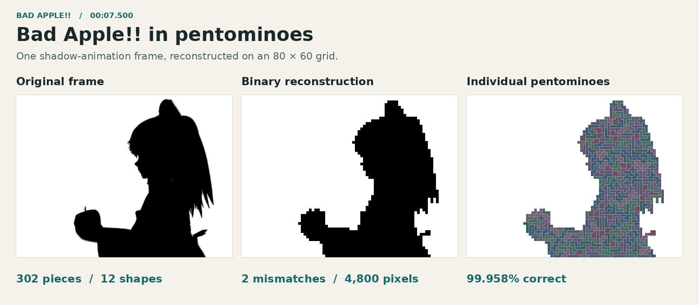

# Bad Apple!! in pentominoes

A Python solver reconstructs one frame of the shadow animation using the 12 free pentominoes. Each piece covers exactly five edge-connected cells. On the 80 × 60 grid, the best packing uses **302 pieces and differs from the target at two pixels**, the minimum allowed by the silhouette’s area.



[Image gallery](results/README.md) · [Evaluation and recommended settings](REPORT.md) · [Measurements for all 31 packings](results/metrics.csv) · [Source frame and attribution](data/README.md)

## Run one frame locally

Use Python 3.12 and install the versions used for the published experiment. The input frame is included.

```sh
python -m venv .venv
. .venv/bin/activate
python -m pip install -r requirements.txt
python -m pentomino solve data/frame0226.png --out runs/demo
```

On Windows PowerShell, activate the environment with `.\.venv\Scripts\Activate.ps1`. The default solve uses 80 × 60, black pieces, approximate placement and eight seconds split between accuracy and diversity. The Dusk palette keeps the piece colors visible in the silhouette. Open `runs/demo/images/solution/dusk.png` and `binary.png` to inspect the result. The JSON and CSV in the same run directory preserve the coordinates and measurements.

```sh
python -m pentomino solve my-frame.png --width 120 --mode white --placement strict --objective modest --seconds 8 --palette mono --out runs/white
python -m pentomino solve my-frame.png --algorithm greedy --objective accuracy --out runs/greedy
python -m pentomino solve --help
```

Widths divisible by four produce an exact 4:3 grid. Input images are center-cropped once to 4:3 and converted to grayscale. Every run saves the crop, the target and the reconstruction. Output directories are intended for one run each.

## Reproduce and verify

```sh
python -m unittest discover -s tests -v
python -m pentomino verify results
python -m pentomino benchmark --replay results/metrics.csv --out runs/replay
```

Replay uses the published seeds and exact numbers of patch attempts. Omitting `--replay` runs the same comparisons under measured wall-clock budgets. The two methods can produce different coordinates on machines with different search speeds. Each benchmark builds the contact sheets and validates the packings. To redraw the published gallery from JSON, run `python -m pentomino gallery results`.

## Implementation

| Module | Responsibility |
|---|---|
| [geometry.py](pentomino/geometry.py) | Generate all 63 orientations, enumerate in-bounds placements and prune candidates by target overlap. |
| [frame.py](pentomino/frame.py) | Apply the common crop, resampling filter and threshold. |
| [packing.py](pentomino/packing.py) | Run the greedy baseline, serialize pieces and independently check their geometry and occupancy. |
| [search.py](pentomino/search.py) | Seed complete interiors and re-tile bounded, overlapping windows for accuracy and diversity. |
| [metrics.py](pentomino/metrics.py) | Measure occupancy, silhouette edges, native-source fidelity, shape frequencies and touching pairs. |
| [benchmark.py](pentomino/benchmark.py) | Define the experiment matrix, record timings and replay fixed work budgets. |
| [render.py](pentomino/render.py) and [gallery.py](pentomino/gallery.py) | Render enlarged grid cells, piece boundaries and comparison sheets. |

The stable JSON format uses zero-based `[x,y]` coordinates from the top left. Each piece has a letter and five explicit cells. In black mode occupied cells are black. In white mode unoccupied cells are black. The renderer can recolor a saved packing independently of the search. [Example packing](results/packings/black-080-contour.json)
