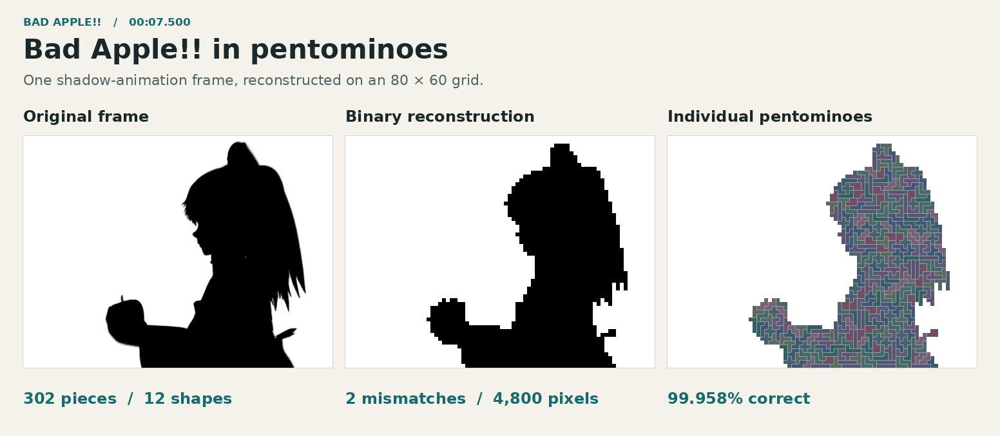

# One frame of Bad Apple!! in pentominoes

**Use 80 × 60 with approximate black pieces, a four-second accuracy pass, a four-second diversity pass and the Dusk palette as the next prototype default.** On the frame at 00:07.500 this took 8.16–8.17 seconds per solve in the managed Linux environment. Seeds 271828 and 314159 produced three and two incorrect grid cells, respectively, with 25 or 26 copies of every shape. The best still used 302 pieces and missed two cells at the silhouette’s edge. [Gallery](results/README.md) · [Full measurements](results/metrics.csv) · [Source and timestamp](data/README.md)

## What is achievable on this frame?

The 80 × 60 target contains 1,512 black cells. A packing occupies a multiple of five, so the black-mode Hamming error is at least two. A 30-second run covered 1,510 intended cells with zero spill, attaining that bound. Both missing cells were visible white pinholes. A further ten seconds of search broke ties using native-source pixel agreement. It moved the misses to grid coordinates (50, 8) and (40, 49), on the outline. The total solve took 40.20 seconds.

Each coarse cell covers 36 source pixels. The two formerly omitted cells were solid black in the source. The new omissions contain 22 and 18 black source pixels. The refined reconstruction gives **1,931 native mismatches** against the thresholded 480 × 360 still, down from 1,995. Even the downsampled target itself has 1,923 native mismatches when enlarged. This is why two packings with the same grid score can look different. The area argument certifies the grid error. The native-source tie-break has no optimality certificate. [Compare the error locations](results/gallery/contour.png) · [Full-sized piece rendering](results/images/black-080-contour/dusk.png)

## Resolution and recognizability

All rows below use the same crop, approximate placements, the modest diversity weight and eight seconds of patch search per mode. “Native IoU” compares the enlarged black reconstruction to the full-size source thresholded at 128. “Target native IoU” measures sampling loss before packing. Grid IoU compares with each resolution’s own target.

| Grid | Pieces, black / white | Errors, black / white | Black mode correct | Black grid IoU | Black edge F1 | Target native IoU | Black native IoU | Black setup + search |
|---|---:|---:|---:|---:|---:|---:|---:|---:|
| 40 × 30 | 77 / 164 | 4 / 3 | 99.667% | .9896 | .9310 | .9364 | .9306 | 8.08 s |
| 60 × 45 | 170 / 368 | 6 / 14 | 99.778% | .9930 | .9372 | .9521 | .9461 | 8.08 s |
| 80 × 60 | 302 / 657 | 16 / 15 | 99.667% | .9895 | .8831 | .9653 | .9567 | 8.09 s |
| 100 × 75 | 474 / 1,024 | 18 / 20 | 99.760% | .9925 | .8948 | .9726 | .9660 | 8.10 s |
| 120 × 90 | 681 / 1,477 | 19 / 41 | 99.824% | .9944 | .9132 | .9754 | .9708 | 8.12 s |

At 40 × 30 the apple and upper body read at a glance, but the apple stem disappears and the hair merges into a single block. At 60 × 45 the arm and head separate more clearly. At 80 × 60 the hair tips and the notch above the wrist resolve while a viewer can still identify individual pieces. At 100 × 75 and 120 × 90 the face and hair track the original more closely. The 120-wide black packing uses 2.25 times as many pieces as the 80-wide one, which makes the pieces harder to read at a fixed display size. All ten resolution/mode packings include all 12 shapes. Black-mode normalized entropy ranges from .9988 to above .9999. [Black resolution comparison](results/gallery/resolution-black.png) · [White comparison](results/gallery/resolution-white.png)

The 80-wide crop was also downsampled with nearest, BOX and Lanczos filters at thresholds 96, 128 and 160. BOX/128 had the highest native IoU of the nine targets (.96533), narrowly ahead of Lanczos/128 (.96528, four changed grid cells). Nearest/128 changed 20 cells and scored .96314. Every packing comparison uses BOX/128. [Sampling measurements](results/preprocessing.csv) · [All targets](results/targets/)

## Which color should be tiled?

Here “missed” and “spill” refer to the color occupied by the pieces. The IoU and edge scores always refer to the black silhouette. Each row uses the same 80 × 60 target, seed, eight-second budget, and modest diversity weight.

| Pieces and rule | Pieces | Missed | Spill | Total errors | Black IoU | Exact edge F1 | Total time |
|---|---:|---:|---:|---:|---:|---:|---:|
| Black, strict | 298 | 22 | 0 | 22 | .9854 | .8527 | 8.08 s |
| Black, approximate | 302 | 9 | 7 | 16 | .9895 | .8831 | 8.09 s |
| White, strict | 651 | 33 | 0 | 33 | .9786 | .7936 | 8.09 s |
| White, approximate | 657 | 9 | 6 | 15 | .9901 | .8967 | 8.11 s |

Permitting boundary crossings reduced the errors in both colors at this budget. Approximate placements can also converge to a zero-spill packing, as the best black result demonstrates. The one-pixel white advantage at 80 × 60 reverses on the second seed (17 black errors and 20 white). At 120 × 90 the black mode has 19 errors to white’s 41. Neither color won every resolution.

Black pieces place the texture inside the character and leave the white field quiet. White pieces keep the figure dark but fill the larger background with 657 pieces. Both eight-second approximate packings reach essentially equal global shape frequencies. The white run admitted 193,008 candidates against 92,788 black, with about 0.105 s versus 0.088 s of preparation and seeding. Fixed search budgets limit what wall-time differences can establish about convergence. [Compare both modes](results/gallery/modes.png) · [Strict and approximate masks](results/gallery/rules.png)

## Accuracy and shape diversity

The search measures Hamming error E on the unadorned occupancy mask. For total pieces N, type counts nᵢ and intended area A, it uses the dispersion Q = Σ(nᵢ − N/12)² / max(A/5, 1). The weighted objective minimizes E + λQ. The denominator keeps the per-piece incentive at a similar scale as the image grows. For comparisons across differing piece counts, the CSV also reports concentration Σpᵢ², normalized Shannon entropy H/ln(12), and square-root evenness Σ√pᵢ/√12.

The two-stage run first minimized pixel error for four seconds. It then minimized Q subject to a cap two pixels above that incumbent, breaking dispersion ties by smaller error. The first-stage incumbent had three errors, allowing at most five. Both stages together received the same eight-second search allowance as the single-stage alternatives.

| 80 × 60 black objective | Errors | Correct | Edge F1 | H / ln(12) | Concentration | Square-root evenness | Errors on second seed |
|---|---:|---:|---:|---:|---:|---:|---:|
| Accuracy only | 3 | 99.938% | .9803 | .90866 | .12732 | .94313 | 2 |
| Modest, λ = 0.8 | 16 | 99.667% | .8831 | .99996 | .08335 | .99997 | 17 |
| Strong, λ = 28 | 16 | 99.667% | .8822 | .99996 | .08335 | .99997 | 11 |
| Two-stage | 3 | 99.938% | .9763 | .99994 | .08336 | .99996 | 2 |

| Objective | F | I | L | P | N | T | U | V | W | X | Y | Z |
|---|---:|---:|---:|---:|---:|---:|---:|---:|---:|---:|---:|---:|
| Accuracy only | 32 | 13 | 34 | 77 | 32 | 16 | 15 | 22 | 7 | 5 | 32 | 18 |
| Modest | 25 | 25 | 26 | 25 | 26 | 25 | 25 | 25 | 25 | 25 | 25 | 25 |
| Strong | 26 | 25 | 25 | 26 | 25 | 25 | 25 | 25 | 25 | 25 | 25 | 25 |
| Two-stage | 25 | 26 | 26 | 26 | 25 | 25 | 25 | 25 | 25 | 25 | 25 | 25 |

Accuracy alone produced 77 P pieces and five X pieces. The two-stage configuration kept the same Hamming error and raised the X count to 25. Single-stage balancing cost 13 pixels on the primary seed, or 0.271 percentage points. A 35-fold increase in λ bought no further evenness on that run. Q is convenient for choosing replacements from the counts. Entropy communicates the outcome on a 0–1 scale. The raw counts show which shapes became rare or frequent across the frame. [Objective comparison](results/gallery/diversity.png) · [Full per-shape distributions](results/metrics.csv)

## Local repetition and shape complexity

A local penalty counts **unique pairs of matching shapes sharing at least one edge**. A pair sharing several edges counts once. A separate experimental reward counts pieces of the four requested types F, W, X and Z. All rows below start from the same modest global objective and have eight seconds of search.

| Extra term | Patch attempts | Errors | Same-shape touching pairs | F/W/X/Z share | Normalized entropy |
|---|---:|---:|---:|---:|---:|
| None | 10,777 | 16 | 68 / 737 | 33.1% | .99996 |
| +0.45 per matching pair | 4,639 | 15 | 0 / 766 | 33.3% | .99994 |
| −0.06 per intricate piece | 10,198 | 14 | 75 / 751 | 43.7% | .99061 |
| −0.45 per intricate piece | 10,626 | 17 | 160 / 723 | 91.4% | .69773 |

The local penalty separated every pair of like-shaped neighbors in the sampled packing. Recounting contacts across the patch boundary cut the attempt rate by 57%. The light complexity reward adds visible crosses and stairs. The larger reward crowds out the other shapes and more than doubles the frequency of matching neighbors. The recommended animation setting keeps the simple global term. Color and seams already make adjacent pieces legible. Longer-range repetition and temporal flicker need separate tests. [Local and complexity comparison](results/gallery/neighborhoods.png)

## Algorithms and effort

The baseline enumerates all legal placements, sorts by immediate error improvement and shuffles equal-gain candidates. The hybrid seeds fully covered 5 × 5 interiors with exact five-piece tilings. It checks grid phase to maximize intact blocks and uses greedy filling elsewhere. Local search then freezes tiles crossing a selected window and replaces only wholly enclosed tiles. Windows span 5 × 5 through 8 × 8. Error cells and random intended cells both receive attention.

Within a window, depth-first search branches on the intended cell with the fewest available placements. It may also leave that cell empty. Five-cell masks make overlap tests and candidate removal inexpensive. Each attempted repair explores at most 240 nodes. The full objective decides acceptance. Equal-value replacements can move holes and create later opportunities. This adapts the constrained-cell heuristic used in exact-cover tiling to a packing with optional coverage and unlimited shape inventory. [Knuth, *Dancing Links*](https://arxiv.org/abs/cs/0011047)

Strict candidates have five intended cells. Approximate candidates require at least three, so each has positive isolated Hamming gain. A placement with only one or two hits could always be deleted to improve accuracy. Candidate pruning restricts the search space of diversity-heavy objectives. At 120 × 90 there are 655,396 geometric placements and 211,236 eligible black candidates. The implementation enumerates the grid once per trajectory and confines combinatorial branching to one window.

| Primary black run | Setup + initialization | Search | Total | Pieces | Errors | Black IoU | Edge F1 | Normalized entropy |
|---|---:|---:|---:|---:|---:|---:|---:|---:|
| Random-tie greedy | .142 s | 0 s | .142 s | 261 | 265 | .8280 | .2946 | .95922 |
| Mosaic + greedy seed | .088 s | 0 s | .088 s | 294 | 80 | .9478 | .5576 | .87261 |
| Modest, very low effort | .088 s | 1.501 s | 1.588 s | 302 | 26 | .9829 | .8118 | .99996 |
| Modest, low effort | .088 s | 8.001 s | 8.088 s | 302 | 16 | .9895 | .8831 | .99996 |
| Modest, medium effort | .088 s | 30.000 s | 30.088 s | 302 | 2 | .9987 | .9844 | .99996 |
| Modest, high effort | .088 s | 75.003 s | 75.090 s | 302 | 2 | .9987 | .9843 | .99996 |

The four timed rows sample the same evolving search using seed 271828. The mosaic initializer processes fewer remaining candidates than greedy after filling the interiors. On this run the hybrid already had fewer holes before its first patch attempt. For fidelity per second, the accuracy-only run reached three errors by 4.085 seconds. For a balanced animation prototype, the second four seconds spent on diversity had a much larger visual effect than another four seconds of accuracy-only search. On the single-stage modest objective, the 30-second packing achieved the pixel lower bound and the most even frequency distribution possible for its 302 pieces. Another 45 seconds changed the placement arrangement but added no gain on either measure. [Effort comparison](results/gallery/effort.png)

## Color and piece boundaries

The bright puzzle palette adapts the hues in Susan’s Math Games, giving the two oranges distinct shades. Existing sources disagree on shape-to-hue assignments. For instance, Susan’s F is orange and L is green, while Gerard’s diagram uses red and blue respectively. The palette is a documented convention adapted for this gallery. [Susan’s naming sheet](https://susansmathgames.ca/wp-content/uploads/2014/07/pentomino-names.pdf) · [Gerard’s Pentomino Page, archived at Brandeis](https://www.cs.brandeis.edu/~storer/JimPuzzles/PACK/Pentominoes/LINKS/PentominoesGerard.pdf)

Puzzle colors make the letters easiest to locate. Dusk uses dark blues, greens and plums so the face and apple read together while individual pieces remain visible. Graphite comes closest to the animation’s dark silhouette, with more reliance on the fine seams. The palette sheet holds all 303 placements fixed. A one-display-pixel seam separates touching pieces, including neighbors of the same type. It never changes the mask. [Palette sheet and legend](results/gallery/palettes.png) · [Graphite at full size](results/images/black-080-lex/mono.png)

## Measurement and remaining questions

- **Fidelity.** Pixel accuracy is 1 − E/(width × height). Black IoU, precision and recall use black as foreground in both modes. Occupied IoU measures the chosen tile color separately. Exact edge F1 compares horizontal and vertical internal grid edges separating opposite colors, preserving their positions and orientations. Image borders are excluded. One displaced contour pixel can alter four edge decisions.
- **Bounds.** Approximate pixel error is bounded below by the distance from intended area to a multiple of five. Strict bounds also count cells unreachable by any placement and the area remainders of four-connected coverable components. These are independently computed bounds on Hamming error. The search is heuristic and supplies no branch-and-bound certificate for its weighted objective.
- **Timing and reproducibility.** All work ran on one search thread in managed x86-64 Linux with Python 3.12.14. The CSV separates target sampling, enumeration, cold patch templates, seeding, search, and the prior stage where relevant. Totals exclude image I/O, gallery rendering and evaluating measurements. A second run using the stored seeds and patch counts reproduced all 31 placement JSON files byte for byte and every non-timing CSV field. Validation checked 12,391 piece instances across the published packings. [Environment](results/environment.json) · [Metrics CSV](results/metrics.csv)
- **Scope.** One frame cannot establish the best resolution, tile color or time budget throughout the video. A black silhouette occupying most of a different shot could reverse the cost comparison. No temporal stability has been measured. The coordinates in each packing can initialize correspondence work on adjacent frames. A subsequent short sequence can measure retained pieces and movement before scaling up to the whole animation.
