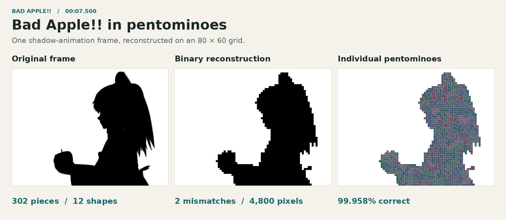

# Single-frame gallery

The overview uses the contour-refined packing. The palette comparison uses the two-stage packing. Each binary PNG comes directly from the occupied cells in its JSON file. The figures below use integer cell sizes.

| Comparison | Images |
|---|---|
| Resolution | [Black pieces](gallery/resolution-black.png) · [White pieces](gallery/resolution-white.png) |
| Target and placement rule | [Black vs. white](gallery/modes.png) · [Strict vs. approximate](gallery/rules.png) |
| Shape mixture | [Diversity objectives](gallery/diversity.png) · [Local repeats and complexity](gallery/neighborhoods.png) |
| Search and presentation | [Effort checkpoints](gallery/effort.png) · [Three palettes](gallery/palettes.png) · [Contour refinement](gallery/contour.png) |

[Original RGB still](../data/frame0226.png) · [Grayscale crop](source-cropped.png) · [Native and enlarged targets](targets/) · [Full metrics](metrics.csv) · [Evaluation](../REPORT.md)

## Individual packings

| Run | Pieces | Wrong pixels | Binary | Piece colors | Coordinates |
|---|---:|---:|---|---|---|
| black-080-greedy | 261 | 265 | [Mask](images/black-080-greedy/mask.png) · [Enlarged](images/black-080-greedy/binary.png) | [Dusk](images/black-080-greedy/dusk.png) | [JSON](packings/black-080-greedy.json) |
| black-080-seed | 294 | 80 | [Mask](images/black-080-seed/mask.png) · [Enlarged](images/black-080-seed/binary.png) | [Dusk](images/black-080-seed/dusk.png) | [JSON](packings/black-080-seed.json) |
| black-080-1p5s | 302 | 26 | [Mask](images/black-080-1p5s/mask.png) · [Enlarged](images/black-080-1p5s/binary.png) | [Dusk](images/black-080-1p5s/dusk.png) | [JSON](packings/black-080-1p5s.json) |
| black-080-modest | 302 | 16 | [Mask](images/black-080-modest/mask.png) · [Enlarged](images/black-080-modest/binary.png) | [Dusk](images/black-080-modest/dusk.png) | [JSON](packings/black-080-modest.json) |
| black-080-30s | 302 | 2 | [Mask](images/black-080-30s/mask.png) · [Enlarged](images/black-080-30s/binary.png) | [Dusk](images/black-080-30s/dusk.png) · [Puzzle](images/black-080-30s/puzzle.png) · [Graphite](images/black-080-30s/mono.png) | [JSON](packings/black-080-30s.json) |
| black-080-75s | 302 | 2 | [Mask](images/black-080-75s/mask.png) · [Enlarged](images/black-080-75s/binary.png) | [Dusk](images/black-080-75s/dusk.png) | [JSON](packings/black-080-75s.json) |
| black-040-modest | 77 | 4 | [Mask](images/black-040-modest/mask.png) · [Enlarged](images/black-040-modest/binary.png) | [Dusk](images/black-040-modest/dusk.png) | [JSON](packings/black-040-modest.json) |
| white-040-modest | 164 | 3 | [Mask](images/white-040-modest/mask.png) · [Enlarged](images/white-040-modest/binary.png) | [Dusk](images/white-040-modest/dusk.png) | [JSON](packings/white-040-modest.json) |
| black-060-modest | 170 | 6 | [Mask](images/black-060-modest/mask.png) · [Enlarged](images/black-060-modest/binary.png) | [Dusk](images/black-060-modest/dusk.png) | [JSON](packings/black-060-modest.json) |
| white-060-modest | 368 | 14 | [Mask](images/white-060-modest/mask.png) · [Enlarged](images/white-060-modest/binary.png) | [Dusk](images/white-060-modest/dusk.png) | [JSON](packings/white-060-modest.json) |
| white-080-modest | 657 | 15 | [Mask](images/white-080-modest/mask.png) · [Enlarged](images/white-080-modest/binary.png) | [Dusk](images/white-080-modest/dusk.png) · [Puzzle](images/white-080-modest/puzzle.png) · [Graphite](images/white-080-modest/mono.png) | [JSON](packings/white-080-modest.json) |
| black-100-modest | 474 | 18 | [Mask](images/black-100-modest/mask.png) · [Enlarged](images/black-100-modest/binary.png) | [Dusk](images/black-100-modest/dusk.png) | [JSON](packings/black-100-modest.json) |
| white-100-modest | 1024 | 20 | [Mask](images/white-100-modest/mask.png) · [Enlarged](images/white-100-modest/binary.png) | [Dusk](images/white-100-modest/dusk.png) | [JSON](packings/white-100-modest.json) |
| black-120-modest | 681 | 19 | [Mask](images/black-120-modest/mask.png) · [Enlarged](images/black-120-modest/binary.png) | [Dusk](images/black-120-modest/dusk.png) | [JSON](packings/black-120-modest.json) |
| white-120-modest | 1477 | 41 | [Mask](images/white-120-modest/mask.png) · [Enlarged](images/white-120-modest/binary.png) | [Dusk](images/white-120-modest/dusk.png) | [JSON](packings/white-120-modest.json) |
| black-080-strict | 298 | 22 | [Mask](images/black-080-strict/mask.png) · [Enlarged](images/black-080-strict/binary.png) | [Dusk](images/black-080-strict/dusk.png) | [JSON](packings/black-080-strict.json) |
| white-080-strict | 651 | 33 | [Mask](images/white-080-strict/mask.png) · [Enlarged](images/white-080-strict/binary.png) | [Dusk](images/white-080-strict/dusk.png) | [JSON](packings/white-080-strict.json) |
| black-080-accuracy-stage1 | 303 | 3 | [Mask](images/black-080-accuracy-stage1/mask.png) · [Enlarged](images/black-080-accuracy-stage1/binary.png) | [Dusk](images/black-080-accuracy-stage1/dusk.png) | [JSON](packings/black-080-accuracy-stage1.json) |
| black-080-accuracy | 303 | 3 | [Mask](images/black-080-accuracy/mask.png) · [Enlarged](images/black-080-accuracy/binary.png) | [Dusk](images/black-080-accuracy/dusk.png) | [JSON](packings/black-080-accuracy.json) |
| black-080-lex | 303 | 3 | [Mask](images/black-080-lex/mask.png) · [Enlarged](images/black-080-lex/binary.png) | [Dusk](images/black-080-lex/dusk.png) · [Puzzle](images/black-080-lex/puzzle.png) · [Graphite](images/black-080-lex/mono.png) | [JSON](packings/black-080-lex.json) |
| black-080-strong | 302 | 16 | [Mask](images/black-080-strong/mask.png) · [Enlarged](images/black-080-strong/binary.png) | [Dusk](images/black-080-strong/dusk.png) | [JSON](packings/black-080-strong.json) |
| black-080-local | 303 | 15 | [Mask](images/black-080-local/mask.png) · [Enlarged](images/black-080-local/binary.png) | [Dusk](images/black-080-local/dusk.png) | [JSON](packings/black-080-local.json) |
| black-080-complex | 303 | 17 | [Mask](images/black-080-complex/mask.png) · [Enlarged](images/black-080-complex/binary.png) | [Dusk](images/black-080-complex/dusk.png) | [JSON](packings/black-080-complex.json) |
| black-080-accuracy-seed2 | 302 | 2 | [Mask](images/black-080-accuracy-seed2/mask.png) · [Enlarged](images/black-080-accuracy-seed2/binary.png) | [Dusk](images/black-080-accuracy-seed2/dusk.png) | [JSON](packings/black-080-accuracy-seed2.json) |
| black-080-modest-seed2 | 301 | 17 | [Mask](images/black-080-modest-seed2/mask.png) · [Enlarged](images/black-080-modest-seed2/binary.png) | [Dusk](images/black-080-modest-seed2/dusk.png) | [JSON](packings/black-080-modest-seed2.json) |
| black-080-strong-seed2 | 303 | 11 | [Mask](images/black-080-strong-seed2/mask.png) · [Enlarged](images/black-080-strong-seed2/binary.png) | [Dusk](images/black-080-strong-seed2/dusk.png) | [JSON](packings/black-080-strong-seed2.json) |
| black-080-light-complex | 302 | 14 | [Mask](images/black-080-light-complex/mask.png) · [Enlarged](images/black-080-light-complex/binary.png) | [Dusk](images/black-080-light-complex/dusk.png) | [JSON](packings/black-080-light-complex.json) |
| white-080-modest-seed2 | 656 | 20 | [Mask](images/white-080-modest-seed2/mask.png) · [Enlarged](images/white-080-modest-seed2/binary.png) | [Dusk](images/white-080-modest-seed2/dusk.png) | [JSON](packings/white-080-modest-seed2.json) |
| black-080-lex-anchor-seed2 | 302 | 2 | [Mask](images/black-080-lex-anchor-seed2/mask.png) · [Enlarged](images/black-080-lex-anchor-seed2/binary.png) | [Dusk](images/black-080-lex-anchor-seed2/dusk.png) | [JSON](packings/black-080-lex-anchor-seed2.json) |
| black-080-lex-seed2 | 302 | 2 | [Mask](images/black-080-lex-seed2/mask.png) · [Enlarged](images/black-080-lex-seed2/binary.png) | [Dusk](images/black-080-lex-seed2/dusk.png) | [JSON](packings/black-080-lex-seed2.json) |
| black-080-contour | 302 | 2 | [Mask](images/black-080-contour/mask.png) · [Enlarged](images/black-080-contour/binary.png) | [Dusk](images/black-080-contour/dusk.png) · [Puzzle](images/black-080-contour/puzzle.png) · [Graphite](images/black-080-contour/mono.png) | [JSON](packings/black-080-contour.json) |
